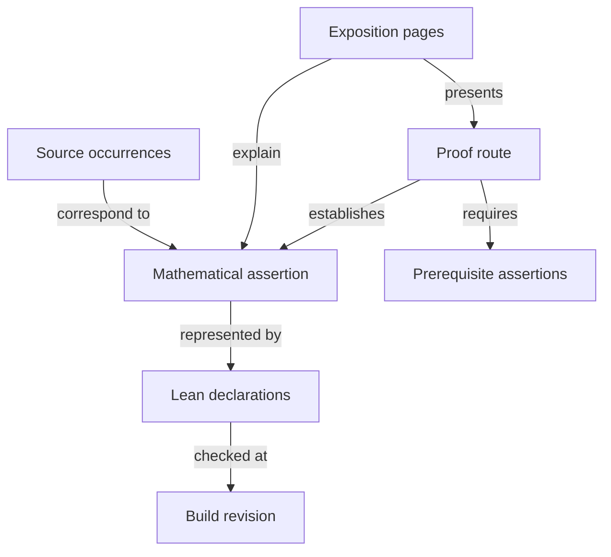

# A mathematical wiki with a formal counterpart

**Design proposal, 12 November 2026.** This accompanies the [project plan](PROJECT_PLAN.md). The wiki should be an independently organised mathematical reference, with natural-language explanations and exact links to Lean. The notes, Grimmett, Heydenreich–van der Hofstad, and the research papers are coverage requirements and source entry points; none supplies the site's master table of contents.

**Navigation decision:** organise the reference as a network of canonical articles, with contextual hyperlinks, generated backlinks, searchable indexes, and clear local logical dependencies. The size of the intended corpus makes maintained reading sequences an unsuitable core structure. Readers should be able to enter at any article or source statement and follow the connections relevant to their question.

## 1. Separate identity, mathematics, proofs, and presentation

The central design is to distinguish five things:

1. **A mathematical assertion or definition.** Its meaning, quantified context, and hypotheses are the object we want to preserve.
2. **An occurrence in a source.** The same fact may occur in several books, with different notation or levels of generality.
3. **A proof route.** A statement can have several proofs, each with different prerequisites and explanatory value.
4. **A Lean implementation.** A declaration provides formal evidence for a precise statement at a particular revision.
5. **An exposition page.** A canonical article may explain several assertions and be linked from any number of other articles, indexes, and source occurrences.

Collapsing these entities causes predictable problems. A page per source duplicates definitions. A page per Lean lemma overwhelms readers with implementation details. A single proof graph confuses alternative routes with jointly required inputs. A theorem-name link without a correspondence review says nothing about whether the prose and Lean mean the same thing.

Give mathematical records permanent opaque IDs, for example `PC-004821`, and stable URLs such as `/id/PC-004821`. Human-readable page paths, theorem numbers, headings, and Lean names can change. An ID resolves to the current canonical explanation and exposes its history. Canonical page URLs and assertion anchors remain stable; title changes retain redirects and searchable aliases. Material corrections create a successor assertion with an explicit correction relation; the original record stays available. Pure moves or renames preserve identity.

Initially the integration maintainer allocates canonical IDs when a task becomes ready; agents do not independently choose the next number. A later collision-resistant allocation tool can replace this convention. CI rejects duplicates and unresolved links. Mechanical source-scan IDs such as `S001` remain in a separate, provisional namespace.

The Stacks Project's permanent tags provide a strong precedent: results can move without losing their references, and a withdrawn result's identifier retains an explanation. We should borrow that identity discipline, while designing our own subject structure and formal verification links. [1]

**Atomic identity does not require an atomic page.** The susceptibility page can contain separately identified definitions and elementary identities. A major theorem can have its own page because its assumptions, proof alternatives, or applications justify one. Small proof-local facts can remain in a lemma family or source-concordance record.

A concordance record alone does not discharge a precise claim. Proof-local assertions retain their local context and must map to checked formal evidence, though that evidence need not become public library API. An alternative proof of the final theorem does not remove these source-coverage obligations.

## 2. Navigation through mathematical facets

Provide several coordinated entry points. These are views onto shared content, not mutually exclusive silos.

| Entry point | Typical questions | Destinations |
|---|---|---|
| Models and geometry | What model am I studying? | Bond/site models, trees, lattices, planar graphs, transitive networks, finite random graphs, tori, hierarchical and Euclidean long range, related dependent models |
| Objects and observables | What quantity or random object do I need? | Clusters, connectivity, susceptibility, magnetisation, tails, moments, arms, largest components, diagrams, IIC, scaling limits |
| Methods | What can this technique prove, and what does it require? | Coupling, exploration, correlation inequalities, pivotality, entropy/OSSS, mass transport, diagrams, lace expansion, RSW, renormalisation, Tauberian arguments |
| Theories and regimes | Which phenomena are established under which assumptions? | Sharpness, subcritical/supercritical theory, mean-field behaviour, hyperscaling, planar criticality, finite-size scaling, marginal logarithms, long-range crossover |
| Index and search | Where is this term, notation, or result explained? | Alphabetical and subject indexes, notation aliases, source theorem numbers, stable IDs, and Lean declaration names |
| Sources and coverage | Where is a source statement represented and how far is its proof? | Edition-specific concordances, corrections, coverage reports, and exact declaration mappings |

For example, a universal tightness theorem is discoverable from finite clusters, moment methods, hyperscaling, and both Euclidean and hierarchical model pages. These links all reach one reviewed result. Its explanation can have several applications without being copied into each model's chapter.

Use a restrained hierarchy for orientation: broad hubs, canonical subject pages, and specific result anchors. Contextual links carry the mathematical relationships that do not fit a tree. Link a term where it is used, a hypothesis where it is imposed, and an input at the proof step that needs it. A reader should always be able to tell what assumptions are in force and why following a link will help.

The core navigation has no prescribed previous/next sequence. Article links, backlinks, local dependency views, indexes, and the source concordance should remain useful as the corpus grows without requiring an editor to place every new result in a curriculum.

## 3. Page types and their contracts

### Concept pages

Explain the object, why it is useful, its exact definition, and important variants. Include a small example or counterexample, source notation aliases, and links to conversion or comparison results. Definitions must be usable outside their original chapters.

The **Cluster observables** page should distinguish the full cluster, the cluster using only edges in a region, and the intersection of the full cluster with that region. It should also distinguish largest restricted clusters from largest intersections. Ordinary, conditioned, and size-biased laws need separate records.

The **Criticality** page should distinguish infinite-cluster thresholds from finite-graph critical windows. The **Asymptotics and exponents** page should distinguish logarithmic exponent limits, bounds up to constants, asymptotic equivalence, and exact leading constants. These are mathematical distinctions, not notation preferences.

### Result and lemma-family pages

Each important assertion has:

- A short statement of significance in ordinary language.
- Background notation and running hypotheses in a visible setting block, with their scope stated.
- The exact theorem statement, introducing the additional hypotheses and parameters of that result and stating all constant dependencies.
- Contextual definition links for the objects, symbols, and hypotheses in the statement, with an explicit account of what is conditional.
- One or more proof explanations, with prerequisites linked at their point of use and the status of each proof recorded separately.
- A local dependency panel that distinguishes concepts needed to read the statement, the mathematical inputs to a selected proof, and dependencies actually extracted from a compiled Lean declaration.
- Direct consequences and applications, grouped by topic.
- Generalisations, special cases, and equivalent formulations, with the bridge justified.
- Source occurrences and attribution.
- A formalisation panel showing the declaration, source code, checked revision, and proof evidence separately from the source's mathematical status.

Do not hide restrictive hypotheses in a collapsed side panel while displaying an apparently unconditional headline. A model filter can help find applicable results, but it must not remove assumptions from the statement.

#### Running context and the hypotheses of a result

The page setting establishes the objects and conventions shared across the discussion: a host graph, the probability law, cluster notation, or an ambient geometric framework. A theorem introduces its own additional assumptions and quantified parameters at the point where it asserts the conclusion. In the small-parameter susceptibility theorem, countability, independent edge states, and the convention that q vanishes on nonedges belong to the setting; the existence or choice of m < 1 with a uniform row-sum bound belongs inside the theorem.

This is a mathematical editorial judgement, not a mechanical classification by whether a phrase is a hypothesis. A hypothesis can legitimately run through an entire section. Conversely, being used in every line of a theorem's proof does not make a theorem-specific assumption part of the page's background. An author should be able to add another theorem in the same framework without accidentally inheriting the first theorem's extra restrictions. Quantifier scope must be explicit: prefer “Let m ∈ [0,1), and suppose … Then …” when the conclusion uses m.

The canonical formal statement always includes the complete quantified context, regardless of where it is displayed. Statement exports and isolated transclusions must carry the relevant inherited setting as well as the local hypotheses. Moving an assumption between prose blocks is not a weakening of the mathematical statement. The prototype calls the shared top-level field `context`; theorem-specific hypotheses live in the result's section.

### Method pages

Explain a reusable argument: the information it takes as input, what it produces, why it works, and where its hypotheses fail. Link to a simple worked example and then stronger applications. A method page should be useful to a mathematician choosing a proof route, not just a list of lemma names.

Examples are finite exploration and deferred decisions, disjoint edge witnesses, the finite-size criterion, the open-triangle argument, entropy comparison, diagrammatic bootstrap, arm gluing, and moment-flow induction.

### Model and regime pages

State the exact model family and its parameterisation. List which assumptions have been verified, which theorem families apply, and which regions remain conditional or open. Keep comparable kernels, asymptotically equivalent kernels, and an exact power-law kernel separate when the sources distinguish them.

For long-range models, use explicit subpages for Euclidean and hierarchical geometry, the upper-critical relation, spatial stable/Brownian behaviour, and localisation hypotheses. The phrases "high-dimensional" or "effectively long-range" must resolve to exact conditions for the result being discussed.

### Contextual links and local orientation

Articles should be readable in their own right. Give enough local explanation to follow a statement or argument, and hyperlink the concepts, hypotheses, source formulations, and intermediate results that a reader may want to inspect. Dense linking means meaningful connections throughout the mathematical prose, not repeated links on every occurrence of the same word.

Each page exposes its direct prerequisite concepts and proof inputs, followed by generated backlinks grouped by relationship: where this definition is used, which proofs use this result, which results specialise it, and which source occurrences it covers. Links should target the relevant assertion anchor when a page contains several distinct facts.

Offer bounded expansion around the current result, with filters for relationship type and model or regime. Keep the selected proof and its assumptions visible while inspecting its inputs. A missing dependency record must be labelled as unrecorded or not yet extracted; an empty panel must not imply that a proof has no prerequisites.

The project does not maintain a separate reading-route catalogue. Source tables of contents remain available as source concordances, and subject indexes provide entry points without prescribing an order through the material.

### Source pages

Preserve each source's edition-specific order and list all precise mathematical occurrences. Each entry links to the canonical assertion or unresolved issue, shows the correspondence and proof status, and identifies relevant corrections. This is how a reader can ask for "everything in Grimmett" without making Grimmett's table of contents the library architecture.

Do not turn source pages into copies of books. Use bibliographic locators, concise original descriptions, and the project's own mathematical formulations and explanations.

## 4. The links must have explicit meanings

| Relationship | Meaning | Reverse view |
|---|---|---|
| `defined_using` | A concept's definition uses another concept | Definitions using this concept |
| `requires_to_state` | An assertion needs a definition or context to be understood | Statements using this object |
| `proof_uses` | An authored record says a selected mathematical proof uses an assertion; the record carries planned or reviewed status | Direct uses in mathematical proofs, with use locations and status |
| `lean_proof_uses` | An extractor records an actual declaration reference reachable from a compiled proof term at an exact revision | Formal uses at that checked revision, with direct or transitive scope stated |
| `lean_statement_uses` | An extractor records declarations used in a compiled declaration's type | Formal statements referring to this definition |
| `specialises` | A reviewed substitution or restriction derives this result from another | Known specialisations |
| `equivalent_under` | Equivalence has specified hypotheses and a proof | Equivalent formulations |
| `generalises` | A precise extension with an identified specialisation map | Generalisations |
| `analogous_to` | A useful mathematical analogy, not an implication | Related analogues |
| `occurs_in` | An assertion corresponds to a specific source passage | Source coverage |
| `implemented_by` | A reviewed Lean declaration represents the assertion | Natural-language explanation of a declaration |
| `mentions` | An article discusses another concept or result without asserting logical dependence | Articles mentioning this topic |
| `corrects` | A reviewed replacement for an inaccurate source formulation | Correction history |

Generate backlinks from the same records as forward links. In particular, generalisation and specialisation are reverse views of one stored relationship, not two fields that contributors must maintain separately. Show direct dependants by default, grouped by type and subject; offer transitive closure on demand. Do not present thousands of unfiltered technical references as useful exposition.

Ordinary prose hyperlinks can generate `mentions` backlinks automatically; authors add the stronger relationship types only when their meaning is justified. "See also" remains available for editorial suggestions, but important mathematical relationships should use a specific link type. Clicking "equivalent" must reveal the hypotheses and proof, not just a similarly titled page. The visible label must distinguish a useful conceptual link from a logical implication or a compiled proof dependency.

## 5. Keep different graphs separate

There are distinct structures with different kinds of evidence:

| Structure | Purpose | Cycles |
|---|---|---|
| Conceptual article links | Definitions, examples, analogies, orientation, and navigation | Expected and useful |
| A selected mathematical proof | Authored logical inputs, with planned or reviewed status and a specific proof strategy | A complete proof must have a well-founded dependency structure |
| Compiled declaration dependencies | References extracted from declaration types and proof terms at an identified build revision | Governed by Lean's declaration dependency discipline |
| Lean module imports | Build organisation and availability of declarations | Governed by Lean's module dependency discipline |
| Source order and correspondence | Complete coverage and provenance | Order is source-specific; mappings are many-to-many |

Alternative mathematical proofs need their own records. Here a proof route means a specific argument establishing a result, not a reading sequence through the wiki. The target is proved if one complete route establishes it; within a route all its stated prerequisites are required. The union of alternative routes need not be a DAG: equivalent statements can imply one another through different proofs. Do not insert every equivalence link into the production dependency graph.

The core record relationships are:

Leanblueprint's distinction between dependencies needed to state and to prove a theorem is useful here. Its mathematical map can be one generated view. The default page view should show a small neighbourhood around the current assertion, with separate sections for **concepts used in the statement**, **inputs to this mathematical proof**, and **compiled Lean dependencies**. Readers can expand one level at a time or inspect direct dependants. [2]

Authored proof inputs are useful before formalisation, but must retain their planned or reviewed status. The compiled view appears only when the extractor has recorded the actual declaration dependencies for the displayed commit and dependency lock. Label whether it reports direct references or transitive closure, and distinguish dependencies of the statement from those of the proof. Importing a module does not make every theorem in that module necessary to a proof. A curated mathematical explanation of the extracted graph may suppress implementation details only if the exact underlying view remains inspectable.

This provides clear logical structure without making a global graph or a maintained syllabus the way to navigate the reference. Cross-links can be abundant while each local proof panel remains selective and precise.

This design matters in practice. The long-range trilogy contains conditional results and generic inequalities that cross paper boundaries; treating each paper as a single dependency node makes the structure misleading. Likewise, lace expansion and real-space methods can provide alternative inputs to a shared mean-field theorem.

## 6. Three worked organisational examples

### Example A: susceptibility across all sources

**Canonical concept:** susceptibility at a specified root under a specified law, initially an extended nonnegative quantity.

**Separate assertions:** its identity with a sum of connection probabilities; monotonicity under a coupling; the row-sum pilot bound; finiteness below a model's critical threshold; a finite-graph normalisation used to locate a critical window.

**Separate variants:** truncated susceptibility excluding infinite clusters, box-restricted susceptibility, and size-biased moments. A similar symbol in a source does not justify identifying these quantities.

**Links:** product law and cluster definition → susceptibility concept; the expectation identity links to Tonelli; the pilot links to simple-path witnesses; sharpness links to the finite-size criterion; triangle-condition consequences link to differential inequalities. Source occurrences in all requested texts point into this shared structure.

The reader can enter from an elementary example, from a theorem in a book, from critical random graphs, or from long-range renormalisation. All these entry points link to the same canonical definitions where they really agree.

### Example B: triangle condition and mean-field theory

Keep the diagram definition, the abstract implication theorem, and verification in a particular model separate. A model-specific infrared bound should link to the exact abstract statement it satisfies. A slowly diverging diagram and a finite diagram can lead to different quantitative statements; a shared page title must not obscure that difference.

Offer alternative proof routes where they matter: classical differential inequalities, a quantitative modern route, and model-specific ways of establishing the needed diagram control. Planar pages can link to the limits of this method without suggesting their proofs pass through it.

### Example C: cutoff families, localisation, and scaling limits

Use separate concept records for hard truncation, the integral cutoff family, finite-box restrictions, full-law clusters, size biasing, and conditioning. The derivative of a cutoff kernel and the total omitted intensity are explicit mathematical assertions.

Give CL, wCL, and the hydrodynamic condition separate definitions. Each implication arrow identifies a theorem and its model assumptions. A hypothesis verified in one parameter range does not become an unconditional property of the entire model family.

For spatial limits, distinguish the cutoff motion kernel from the full-space kernel, scalar normalisation from anisotropic linear normalisation, moment convergence from convergence in law, and convergence of finite measures from convergence of supports or metric spaces. These distinctions deserve links because later arguments use them in different ways.

## 7. Indexes, backlinks, and local dependency views

The growing corpus needs a small set of dependable entry points, generated from shared records where possible:

1. **Subject and model indexes:** probability foundations, general percolation, planar theory, mean-field mechanisms, finite random graphs, long-range models, and limits. An article may belong to several indexes without being duplicated.
2. **Term and notation index:** canonical names, symbols, source-specific aliases, stable assertion IDs, and Lean declaration names.
3. **Source concordance:** each edition's sections and precise occurrences mapped to canonical assertions, with corrections and coverage status.
4. **Per-page backlinks:** articles mentioning the topic, definitions using it, selected proofs requiring it, specialisations, applications, and source occurrences.
5. **Local logical dependencies:** a bounded view around one assertion or proof, with explicit link types and a clear distinction between authored mathematical inputs and compiled formal references.

A new article should become discoverable by linking it from the concepts and results it actually relates to and by assigning appropriate index metadata. Contributors do not need to update hand-authored sequences for every audience. Source order remains navigable through the source concordance; it does not prescribe the order of the canonical articles.

For example, the triangle-condition page links its diagram symbols to connectivity and summation, its abstract consequences to sharpness and differential inequalities, and model-specific verifications to their infrared bounds. Backlinks reveal all articles that use those concepts or results. The dependency panel separately shows which inputs a particular proof needs and which dependencies have been extracted from its Lean implementation.

## 8. Authoring, generation, and consistency

Store human-readable prose in small reviewable text files, and structured records in small per-assertion or per-family files. Avoid a single giant shared registry file that every contributor must edit. A registry schema should distinguish assertion IDs, source-occurrence IDs, mathematical-proof IDs, and page IDs. No reading-sequence record is needed for the core reference.

The minimal assertion record contains its kind, canonical page/anchor, exact mathematical context, reviewed formulation, source-occurrence links, formal declaration links, proof-route links, and statuses. Source records contain immutable edition/snapshot identifiers and locators. Proof records identify their prerequisites and whether they are plans, implemented arguments, or reviewed formal proofs.

Keep the following fields separate:

- **Kind:** definition, mathematical assertion, conjectural assertion, heuristic, or another explicitly identified kind.
- **Literature standing:** known with an identified proof, open, disputed, corrected, or awaiting clarification. The occurrence's own classification is retained as provenance.
- **Hypotheses:** part of the exact statement. An established theorem may be conditional; this is not a competing status category.
- **Correspondence review:** recorded on each source-occurrence–assertion and assertion–Lean mapping, with exact revisions and any substitution, specialisation, or equivalence bridge. An assertion-level badge is only a derived summary; approval of one mapping does not approve the others.
- **Formal status:** no formal statement yet, statement checked, proof in progress, or proof verified at an identified revision.

A conditional mathematical theorem may be fully verified. A conditional reduction obtained by assuming a missing input does not complete an unconditional target. A conjecture with a well-formed Lean proposition is not a proved theorem. The interface should say these things directly, rather than using a single ambiguous green indicator.

Generate repeated exact statement blocks, declaration displays, indexes, backlinks, source matrices, and proof badges from canonical records and build evidence. Build the backlink index from the actual outgoing article links and typed relationships, so it cannot silently disagree with them. Generate compiled dependency records from the checked Lean environment, separately from authored conceptual links and proof plans. CI emits a verification manifest after the build, keyed by the checked commit and dependency lock; authored registry records do not certify themselves. A badge combines the matching manifest with the relevant current correspondence reviews. Explanations and proof sketches are authored prose; they are not guaranteed correct just because a Lean declaration exists. Review them with the mathematical PR.

When a definition or statement changes, flag affected correspondence records and explanations as needing review. Keep changes to proof terms separate from changes to statement meaning in history. Publish the wiki, source concordance, and Lean API documentation from the same commit.

Documentation generation is not proof certification. In particular, doc-gen4 can generate documentation for compiling code that contains `sorry`; the project's own axiom and coverage checks must supply the stronger verification claim. [3]

## 9. Technical implementation and first prototype

Use a version-controlled static HTML documentation site, with mathematics rendering, search, permanent anchors, and generated backlinks. Contributors edit through the normal repository PR workflow. The user-facing result is a wiki; a separate publicly editable database is unnecessary for the initial team.

Reuse Lean API documentation generation and blueprint tooling where they help. Keep the registry independent of the page generator. Before choosing a renderer permanently, verify that it handles the project's notation, assertion transclusion, typed backlinks, source aliases, private previews, and revision-specific Lean links. Prefer an existing documentation generator plus a small registry renderer to a custom application platform.

Search should recognise mathematical terms and symbols, author and theorem aliases, source theorem numbers, model/regime tags, stable IDs, and Lean names. Results should show the statement's context. Local graph views should answer a question such as "what does this proof need?" or "what uses this lemma?"; a graph of the entire corpus is not a useful default. Preserve browser back navigation and deep links to page sections and individual assertions, so a reader can inspect a definition and return to the argument that used it.

### Navigation when the corpus becomes large

The sample article count must not determine the navigation architecture. Keep three scopes distinct:

| Scope | Navigation contract |
| --- | --- |
| Whole reference | A short, stable menu for the overview, subjects, search/browse, sources, and formal provenance. The global menu does not enumerate articles. |
| Subject or model | An overlapping subject hub with a concise overview, selected entry points, and a searchable, filterable, paginated article index. Additional subhubs can be introduced without changing article IDs. |
| Current article or assertion | Its contents, shared setting, sources, local prerequisites, direct dependants, and incoming prose links. Long relation lists open a bounded, searchable view. |

A result can appear in several subject/model collections. Membership is metadata; moving an article between collections must not change its canonical URL or duplicate the statement. The source's chapter order is available inside its concordance and does not expand the global sidebar. Search and filters are complementary to contextual prose links; they do not replace them.

Every potentially large list has an explicit result count, a bounded page size, and access to the remaining results. This includes article indexes, search results, source occurrences, prerequisites, dependants, and backlinks. A local diagram may show only a small neighbourhood, but must reveal that it is a subset and link to the complete relation list. Avoid an arbitrary first-N cut that makes omitted relationships undiscoverable. Query, scope, filter and pagination state belong in the URL so readers can share a view and use browser back reliably.

Generate incoming-link indexes and subject membership at build time from forward metadata. Do not scan the text of every article to render a sidebar. Keep a compact navigation/search catalogue separate from full article and source-occurrence payloads, and load these payloads on demand. Full stable IDs must remain unambiguous past a thousand entries. Source records, article records, and proof records should be split into independently reviewable files as the team grows.

The initial client-side catalogue is suitable for a growing static reference. Its size and search latency still grow with the corpus. At a substantially larger corpus, shard or replace the search/index backend while preserving the same result schema, filters, and canonical links; do not promise that the prototype is an already benchmarked million-statement service. Formal dependency extraction likewise requires its own checked pipeline.

Build a **twelve-page design prototype** before a mass migration. Its information design starts at Gate A with representative, accurately labelled records; the pilot's completed proof and evidence arrive at Gate B. It need not delay mathematical implementation:

| Page | What it tests |
|---|---|
| Product percolation | Common law and model-specific instances |
| Connectivity and cluster observables | Definition variants and source aliases |
| Susceptibility | Several atomic assertions on one coherent page |
| Criticality and finite-size windows | Important concepts that must remain distinct |
| Small-parameter susceptibility bound | A complete proof, source correspondence, and Lean evidence |
| Sharpness and the finite-size criterion | Alternative proof routes and a corrected source statement |
| Triangle condition | Abstract theorem versus model verification |
| Universal tightness | One result serving several model programmes |
| Cutoff families and localisation | Similar-looking definitions with different meanings |
| Long-range two-point estimates | Averaged/pointwise and conditional/unconditional variants |
| A finite-random-graph result family | A separate notion of critical scaling using shared foundations |
| Exploration and independent coordinates | A reusable method with links to its probability inputs and several applications |

Provide the subject index, source concordance, term search, and generated backlinks alongside these mathematical pages. The prototype should demonstrate navigation by ordinary mathematical hyperlinks and a local dependency panel with visibly different conceptual, planned-proof, and compiled-proof evidence.

Only the pilot's implemented portion should display a verified badge; other pages can contain reviewed specifications or explanatory plans with accurate status. This prototype is a design test, not a promise to prove all twelve areas in the first sprint.

Acceptance requires a mathematician unfamiliar with the implementation to be able to enter at a source statement or subject article, discover its assumptions, follow linked definitions and one coherent proof explanation, identify what remains unproved, inspect a direct logical prerequisite, and find a downstream application through a backlink. They must be able to distinguish conceptual links and authored proof inputs from actual compiled Lean dependencies. A Lean contributor must be able to find the corresponding declaration and verification revision. Renaming a page or declaration must leave stable assertion links usable; no global reading order is required.

See [the prototype guide](WIKI_PROTOTYPE.md) for the current authoring direction and the checklist for adding an article.

## References

1. [The Stacks Project tag system](https://stacks.math.columbia.edu/tags).
2. [Leanblueprint documentation](https://github.com/PatrickMassot/leanblueprint) and [Tao's PFR blueprint tour](https://terrytao.wordpress.com/2023/11/18/formalizing-the-proof-of-pfr-in-lean4-using-blueprint-a-short-tour/).
3. [doc-gen4 documentation](https://github.com/leanprover/doc-gen4).

The subject examples and source-concordance requirements come from the uploaded draft and the sources listed in the [project plan](PROJECT_PLAN.md). The proposed information structure and page design are recommendations for this collaboration.

## Project metrics and evidence

Provide one permanent Project metrics entry in global navigation. Compute website counts from the same data that builds the reference, and attach repository measurements to an exact branch and commit. The number of written articles, source occurrences, Lean source declarations, and compiled declarations are different quantities; display them separately. In particular, a checked contribution branch must not be counted as merged work on the default branch.

Useful website measurements include articles by type, subject memberships, indexed source records and occurrences, contextual links, curated prerequisite edges, and formal-status counts. Show the definitions of graph and coverage measurements. A page without incoming links is a navigation observation, not evidence that its mathematics is isolated.

The repository panel should show the revision, measurement date, build evidence, and scope of each snapshot. Unknown or unavailable values remain explicitly unmeasured. Compiled declaration counts can include generated declarations; source declaration counts must describe their collection method. Absence of textual proof placeholders is not a substitute for successful kernel checking and an axiom audit.

Do not report a percentage of the literature formalised until a reviewed assertion inventory supplies the denominator. Likewise, do not draw progress curves from invented history. Build-time counts and dated repository snapshots provide an initial measurement system; retained, comparable snapshots can later support trends.
